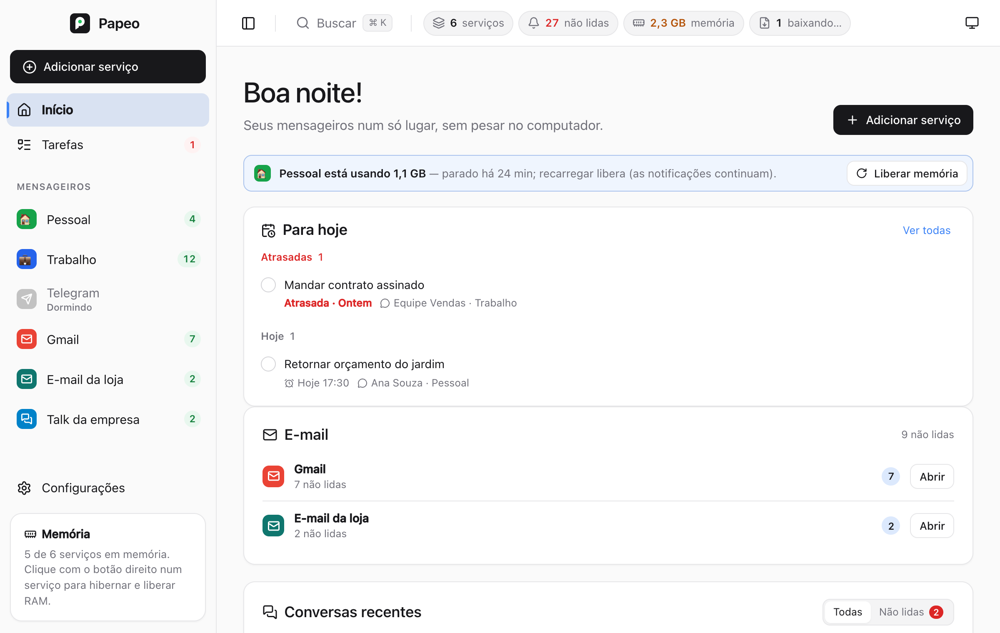
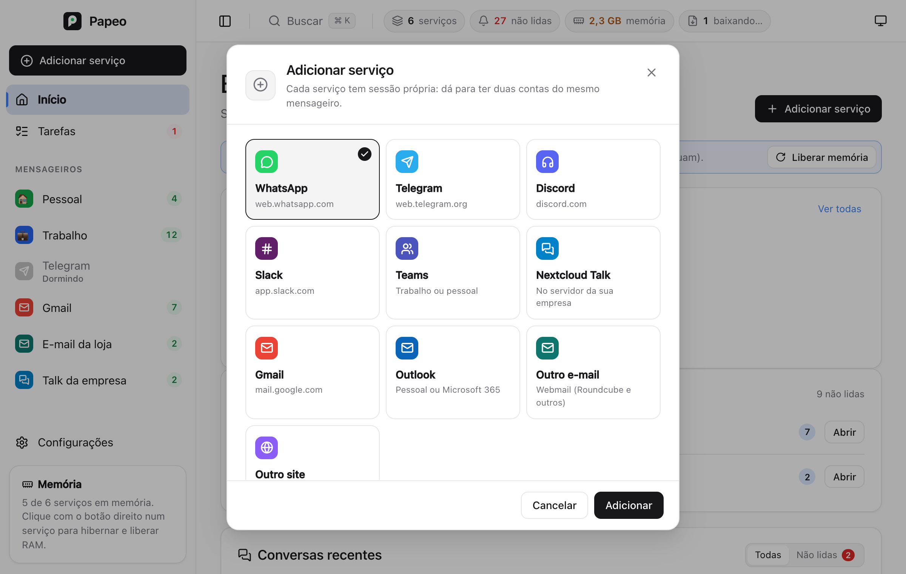
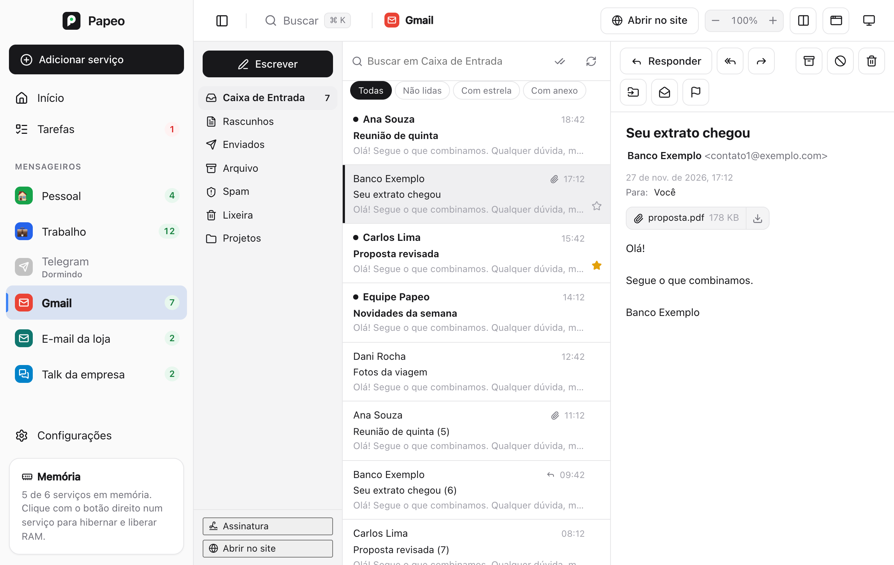
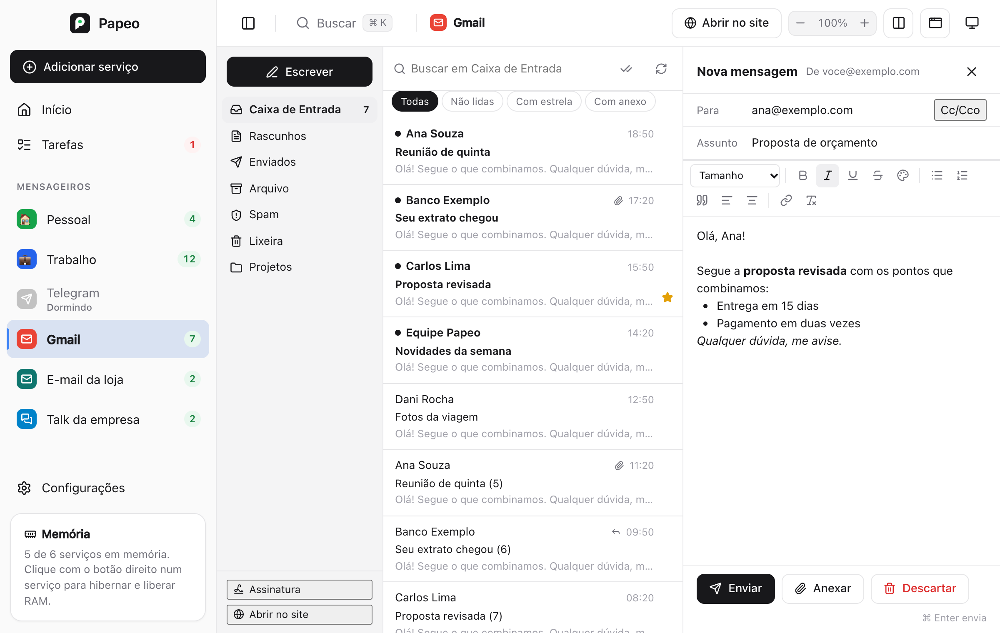
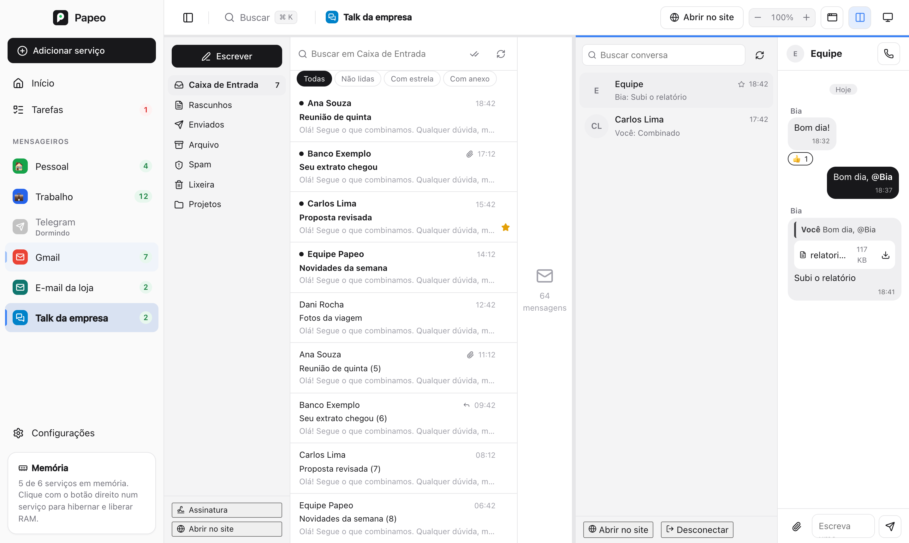
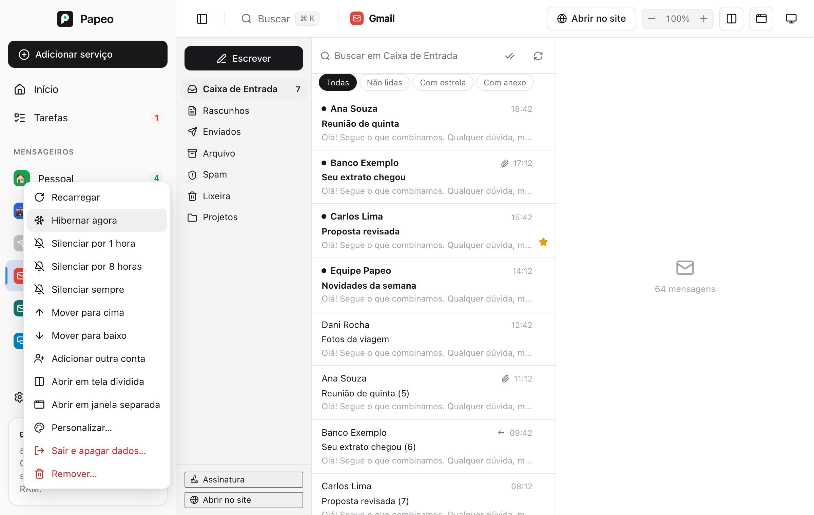
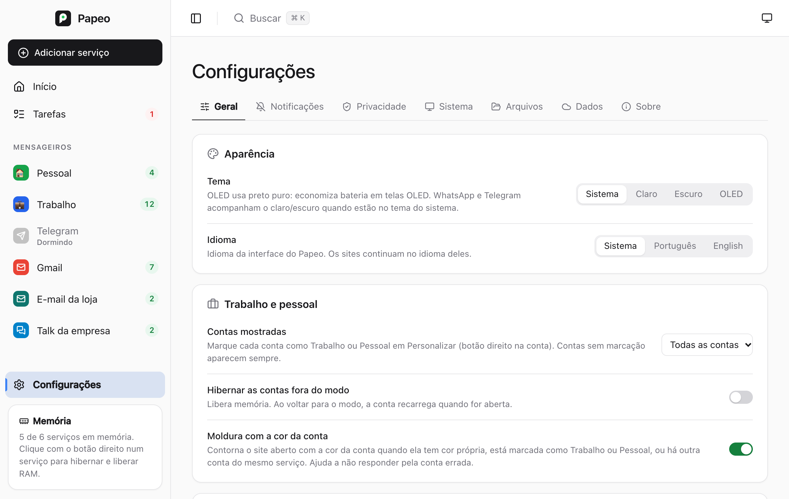
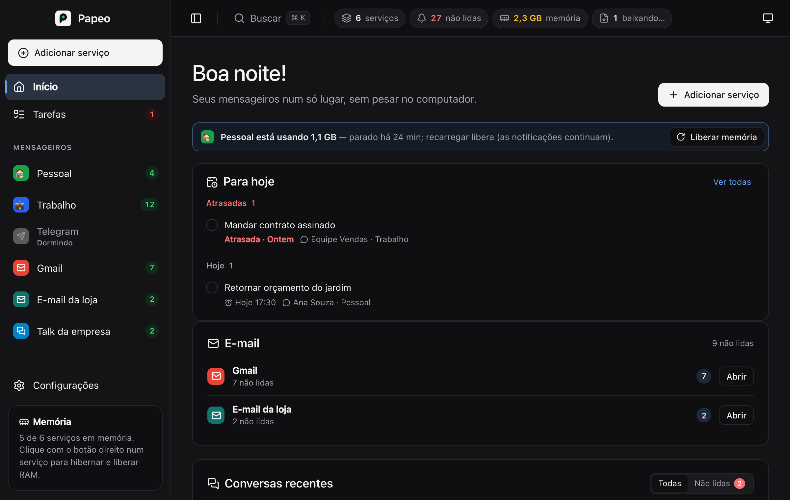

<p align="center">
  
</p>

<h1 align="center">Papeo</h1>

<p align="center">
  <b>WhatsApp, Telegram, Discord e outros sites num só aplicativo.</b><br>
  Para Mac e Windows. Grátis e de código aberto.
</p>

<p align="center">
  <a href="https://github.com/ygormteus/papeo/releases/latest"><b>⬇️ Baixar o Papeo</b></a>
</p>



## Para que serve

Em vez de deixar várias abas abertas no navegador, você junta tudo numa janela só:

- 💬 **WhatsApp, Telegram, Discord, Slack, Teams e Nextcloud Talk** prontos para usar — e qualquer outro site que você quiser.
- ✉️ **Gmail, Outlook e outros e-mails**, pelo site (webmail) ou pelo **leitor de e-mail do Papeo** (IMAP): mais leve, com pastas, busca, anexos, rascunhos e editor com negrito, listas, cores e links.
- 🗨️ **Nextcloud Talk** também no leitor do Papeo, sem carregar o site inteiro.
- 🪟 **Tela dividida**: duas contas lado a lado (o WhatsApp e o e-mail, por exemplo). Ou abra uma conta numa **janela separada**, para outro monitor.
- 👥 **Mais de uma conta** do mesmo aplicativo, por exemplo um WhatsApp **Pessoal** e outro do **Trabalho**, cada um com seu login.
- 🔔 **Notificações** do próprio computador, com contador de mensagens não lidas (também com a barra lateral recolhida) — e dá para **responder direto na notificação**.
- 💭 **Mini janela** no ícone da barra (Mac) ou da bandeja (Windows): leia as últimas conversas e responda sem abrir o app.
- 🌙 **Não perturbe**: silencia tudo por 1 hora, 8 horas ou num horário fixo (ex.: das 22h às 7h).
- 🔒 **Bloqueio com Touch ID** (Mac) ou **Windows Hello**, para ninguém ler suas conversas.
- 🧊 **Economia de memória**: contas que você não está usando podem "dormir".

## Como instalar

### 1. Baixe o arquivo certo

Abra a [página de download](https://github.com/ygormteus/papeo/releases/latest) e escolha:

| Seu computador | Arquivo |
|---|---|
| Mac com chip Apple (M1, M2, M3, M4…) | o que termina em `aarch64.dmg` |
| Mac com processador Intel | o que termina em `x64.dmg` |
| Windows 10 ou 11 | o que termina em `setup.exe` |

> **Não sabe qual é o seu Mac?** Clique na maçã no canto superior esquerdo da tela → **Sobre Este Mac**. Se aparecer "Chip Apple M…", é o primeiro; se aparecer "Processador Intel", é o segundo.

### 2. Instale

**No Mac**

1. Abra o arquivo `.dmg` e arraste o **Papeo** para a pasta **Aplicativos**.
2. Abra o Papeo. Na primeira vez, o Mac vai avisar que não conhece o desenvolvedor — é normal, porque o Papeo ainda não tem a assinatura paga da Apple.
3. Vá em **Ajustes do Sistema → Privacidade e Segurança**, desça até a mensagem sobre o Papeo e clique em **Abrir Mesmo Assim**.

<details>
<summary>Apareceu "o Papeo está danificado e não pode ser aberto" ou a atualização falhou com "Read-only file system"?</summary>

É uma trava do Mac para arquivos baixados da internet. Abra o aplicativo **Terminal**, cole a linha abaixo e aperte Enter:

```sh
xattr -dr com.apple.quarantine /Applications/Papeo.app
```

Depois abra o Papeo normalmente.
</details>

**No Windows**

1. Abra o arquivo `setup.exe`. Ele instala sem pedir senha de administrador.
2. Se aparecer **"O Windows protegeu o computador"**, clique em **Mais informações → Executar assim mesmo**.

Mac: macOS 14 (Sonoma) ou mais novo. Windows: 10 ou 11.

## Primeiros passos

### Adicione suas contas

Clique em **Adicionar serviço**, escolha WhatsApp, Telegram, Discord, Slack, Teams, Nextcloud Talk, Gmail, Outlook, **Outro e-mail** ou **Outro site**, e faça login como faria no navegador (no WhatsApp, leia o QR code com o celular).

No **Outlook**, escolha ao adicionar se a conta é pessoal (Outlook.com, Hotmail) ou de trabalho/escola (Microsoft 365); para receber avisos, ligue **Configurações → Geral → Notificações** no próprio Outlook.

Para e-mails fora do Gmail e do Outlook (contas do seu provedor ou domínio), escolha **Outro e-mail**.

Nas contas de e-mail e no Nextcloud Talk, escolha em **Abrir como**:

- **Site:** como no navegador, com o login de sempre. No Gmail, para receber avisos de e-mails novos, ligue **Configurações → Notificações da área de trabalho** dentro do próprio Gmail.
- **Leitor do Papeo:** bem mais leve, porque não carrega o site. No e-mail, informe o servidor IMAP e a senha (no Gmail, uma [senha de app](https://myaccount.google.com/apppasswords)); o Papeo já sugere o servidor dos provedores mais comuns. No Talk, clique em **Conectar ao Talk** e aprove o acesso no navegador. Quando precisar, **Abrir no site** mostra a página completa.



Para ter **duas contas do mesmo aplicativo**, é só adicionar de novo (ou botão direito → **Adicionar outra conta**). Dica: dê nomes como "Pessoal" e "Trabalho" para não confundir.

### E-mail no leitor do Papeo

Com a conta aberta no leitor, você tem as pastas do servidor, busca, filtros (não lidas, com estrela, com anexo), arquivar, mover, marcar como spam e responder ou encaminhar, sem carregar o site.



Em **Escrever**, a barra de formatação tem tamanho da letra, negrito, itálico, sublinhado, cor, listas, citação, alinhamento e link. A assinatura (também formatada) fica em **Assinatura**, e o envio pode ser desfeito por alguns segundos (**Configurações → Geral → Desfazer envio**).



### Duas contas ao mesmo tempo

- **Tela dividida:** arraste uma conta da barra lateral para a esquerda ou a direita do conteúdo, use o botão **Dividir a tela** na barra de cima ou o botão direito → **Abrir em tela dividida**. Arraste o divisor do meio para mudar o tamanho; **Fechar divisão** volta a uma conta só.
- **Janela separada:** botão direito → **Abrir em janela separada** (ou o botão na barra de cima). A conta vai para uma janela própria, que dá para levar a outro monitor; fechar a janela devolve a conta à janela principal.



### Personalize com o botão direito

Clique com o **botão direito** numa conta da barra lateral para mudar nome, cor e emoji, silenciar as notificações, colocar para dormir, mudar a ordem, abrir em tela dividida ou numa janela separada, ou remover.



### Ajuste do seu jeito

Em **Configurações** você escolhe o tema (claro, escuro ou preto total), o idioma (português ou inglês), o não perturbe, o bloqueio com senha, as assinaturas de e-mail, a pasta de downloads e se o Papeo abre junto com o computador.



### Responda sem abrir o app

Clique no ícone do Papeo na **barra de menus** (Mac, lá em cima) ou na **bandeja** (Windows, perto do relógio). Abre uma janelinha com as últimas conversas: escreva a resposta e aperte **Enter**. Com o botão direito no ícone aparece o menu com contas, não perturbe e bloqueio.


Nas notificações do WhatsApp e do Telegram também aparece **Responder**: digite ali mesmo e envie.

### Tarefas, lembretes e anotações

Conversando com alguém, clique no botão de **bloco de notas** na barra do topo (ou `⌘ ⇧ N` / `Ctrl Shift N`). Abre um painel ao lado da conversa, que continua à vista:

- **Nova tarefa:** escreva e, se quiser, escolha quando avisar (*Em 1 h*, *Hoje 18h*, *Amanhã 9h*…). Dá também para escrever a data no texto: "retornar orçamento **amanhã 15h**", "pagar boleto **dia 5**", "ligar **em 30 min**".
- A tarefa fica **ligada à conversa**: na hora marcada chega um lembrete, e um clique abre aquela conversa na conta certa. Para uma tarefa solta, tire o vínculo no ✕.
- **Repetir:** todo dia, dias úteis, toda semana ou todo mês.
- **Anotações:** um bloquinho por contato (preferências, combinados, histórico), salvo sozinho.

Tudo aparece também em **Tarefas** (barra lateral), no cartão **Para hoje** do Início, na janelinha da barra de menus e na busca (`⌘ K`). Nos lembretes, **Adiar 1 h** e **Concluir** funcionam direto na notificação.

### Veja anexos antes de baixar

Em **Configurações → Arquivos → Anexos → Visualizar antes**, a planilha, o PDF, o documento ou a foto que alguém mandar abre numa janela do Papeo quando você clica, sem ir para a pasta de downloads. De lá:

- **Salvar** guarda na pasta de downloads;
- **Abrir no app** abre no Excel, Word, leitor de PDF etc. para editar (o Papeo salva uma cópia na pasta de downloads antes, então o que você editar não se perde);
- fechar descarta o arquivo.

No Mac, a visualização é a mesma do Quick Look (barra de espaço no Finder) e mostra também Excel, Word e PowerPoint. No Windows, PDF e imagens aparecem na janela; Excel e Word vão pelo **Abrir no app**. Outros tipos de arquivo são salvos direto, como antes.

No leitor de e-mail, os anexos aparecem no topo da mensagem: clique para ver, ou use o botão ao lado para salvar.

### Tema escuro



## Sobre o uso de memória

Cada conta do WhatsApp é, por dentro, o **WhatsApp Web** — o mesmo que você abriria no navegador. Ele costuma usar de **1 a 2 GB de memória por conta**, e isso vem do próprio WhatsApp, não do Papeo (que sozinho usa uns 50 MB).

Para economizar:

- **Use o leitor do Papeo** no e-mail e no Talk: ele não carrega o site, gasta bem menos memória e continua avisando das mensagens novas.
- **Durma o que não está usando:** botão direito → **Hibernar agora**, ou escolha em quanto tempo cada conta dorme sozinha. Conta aberta pelo site, dormindo, **não recebe notificações**.
- **Recarregar automático:** em **Configurações → Sistema**, o Papeo recarrega uma conta que ficou pesada enquanto você não está olhando para ela. As notificações continuam.

## Atalhos de teclado

| O que fazer | Mac | Windows |
|---|---|---|
| Ir para a tela inicial | `⌘ 0` | `Ctrl 0` |
| Ir para a conta 1, 2, 3… | `⌘ 1` … `⌘ 9` | `Ctrl 1` … `Ctrl 9` |
| Buscar uma conta | `⌘ K` | `Ctrl K` |
| Adicionar serviço | `⌘ N` | `Ctrl N` |
| Configurações | `⌘ ,` | `Ctrl ,` |
| Bloquear agora | `⌘ L` | `Ctrl L` |
| Tarefas e anotações da conversa | `⌘ ⇧ N` | `Ctrl Shift N` |
| Alternar trabalho e pessoal | `⌘ ⇧ M` | `Ctrl Shift M` |
| Aumentar / diminuir o zoom | `⌘ +` / `⌘ −` | `Ctrl +` / `Ctrl −` |
| Voltar o zoom a 100% | `⌘ ⇧ 0` | `Ctrl Shift 0` |

No **leitor de e-mail**: `/` busca, `j`/`k` (ou as setas) andam na lista, `r` responde, `a` responde a todos, `f` encaminha, `e` arquiva, `#` apaga, `s` marca com estrela, `u` marca como não lida e `Esc` desfaz a seleção. No editor, `⌘ B`/`I`/`U` (Windows: `Ctrl`) formatam e `⌘ K` cria um link.

## Perguntas frequentes

**Minhas conversas passam pelo Papeo ou por algum servidor dele?**
Não. O Papeo só abre os sites oficiais (como o WhatsApp Web) dentro dele. Não existe servidor do Papeo, não há propaganda nem coleta de dados. A única coisa que ele consulta por conta própria é se existe versão nova — e dá para desligar em **Configurações → Sistema**.

**Como atualizo?**
O Papeo confere a cada 2 horas se há versão nova. Quando houver, aparece **Atualizar e reiniciar** na barra lateral, com **Ver o que mudou** para conhecer as novidades antes. É só clicar; seus logins continuam. Depois de atualizar, o Papeo mostra uma vez o que mudou.

**Não chegam notificações. O que faço?**
Confira se a conta não está dormindo (no leitor do Papeo, se não aparece "Senha recusada" no Início), se as notificações dela estão ligadas, se o **não perturbe** está desligado e se o computador permite notificações do Papeo.

**Uma conta aparece "desconectada".**
O login expirou. Abra a conta e entre de novo.

**Microfone ou câmera não funcionam.**
Clique com o botão direito na conta → **Personalizar…** e libere microfone e câmera. Confira também a permissão do sistema (Mac: **Ajustes → Privacidade e Segurança**; Windows: **Configurações → Privacidade**).

**Como passo para outro computador?**
Em **Configurações → Dados**, exporte o arquivo e importe no outro computador. Vão junto as contas, as preferências, as tarefas e as anotações; os logins e as senhas de e-mail não: entre de novo em cada conta.

**Como desinstalo e apago tudo?**
Antes de desinstalar, remova cada conta (botão direito → **Remover…**); isso apaga os logins daquele computador. Depois apague o aplicativo normalmente.

## Privacidade

- Cada conta fica **separada**, com seu próprio login.
- Remover uma conta **apaga** os dados dela do computador.
- Você escolhe o que aparece nas notificações: a mensagem inteira, só quem mandou, ou nada.
- O bloqueio esconde todas as conversas até você usar o Touch ID, a senha ou o Windows Hello.
- Dá para esconder a janela do Papeo em gravações e compartilhamentos de tela.
- Tarefas e anotações ficam só no seu computador (e no backup, se você exportar).
- No leitor do Papeo, o e-mail vai direto do seu computador para o servidor IMAP/SMTP, e o Talk direto para o servidor Nextcloud. As senhas ficam só neste computador (no Windows, no Gerenciador de Credenciais; no Mac, num arquivo que só o seu usuário lê), fora do backup e da sincronização. No Talk, o Papeo usa uma senha de app que você aprova no navegador: ele nunca vê a senha da sua conta.
- Imagens de fora nos e-mails ficam bloqueadas até você pedir, para o remetente não saber quando você abriu.

## Para desenvolvedores

Como compilar, testar e publicar versões: veja o [guia de contribuição](CONTRIBUTING.md).

## Quem fez

O Papeo é criado e mantido por **[Ygor Moura](https://github.com/ygormteus)**. Achou um problema ou tem uma ideia? [Abra um relato aqui](https://github.com/ygormteus/papeo/issues).

## Licença

[GPL-3.0](LICENSE): você pode usar, estudar, modificar e compartilhar o Papeo à vontade. Quem distribuir uma versão modificada precisa publicar o código dela também.

Inclui o [RNNoise](https://gitlab.xiph.org/xiph/rnnoise) (BSD-3-Clause, Xiph.Org e colaboradores), compilado para WebAssembly pelo [Jitsi](https://github.com/jitsi/rnnoise-wasm) (Apache-2.0), usado na limpeza das mensagens de voz. Licenças e origem em [`src-tauri/vendor/rnnoise`](src-tauri/vendor/rnnoise).
