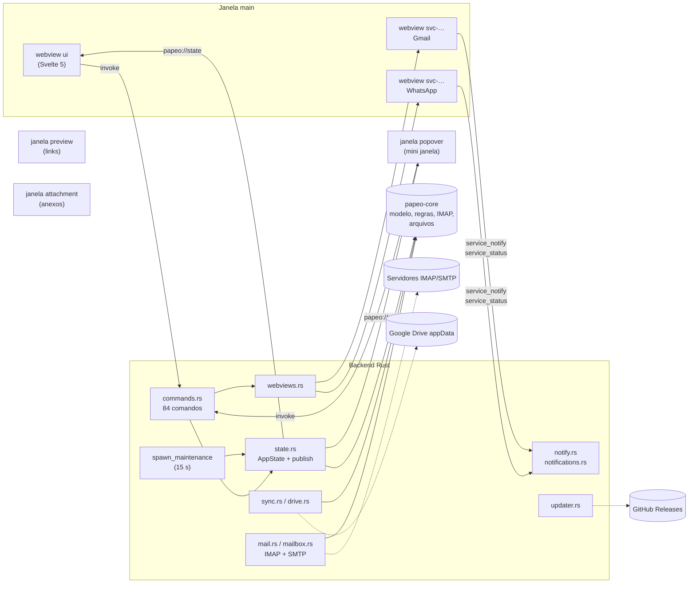
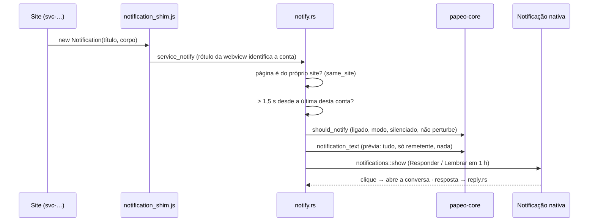

# Papeo — Documento de Design de Software

- **Versão do app descrita:** 0.13.0
- **Público:** quem vai mudar o código do Papeo
- **Atualizar quando:** mudar um contrato da §12, um arquivo persistido
  (§6), um comando ou capability (§7) ou uma decisão (§13)

## 1. Propósito e escopo

O Papeo junta mensageiros e e-mail (WhatsApp, Telegram, Discord, Gmail,
Outlook, webmail, qualquer site) numa janela só no macOS e no Windows. Cada
conta é o próprio site, aberto numa webview do sistema com sessão isolada.
Em volta disso o app acrescenta notificações nativas, não perturbe,
bloqueio, tarefas ligadas a conversas, resposta rápida, leitor de e-mail
por IMAP e economia de memória.

Este documento descreve **como o Papeo é construído hoje**. O
comportamento esperado de cada recurso fica nas especificações de
[`specs/`](specs/README.md).

### Objetivos

1. **Leveza:** usar a webview do sistema (WKWebView, WebView2) em vez de um
   Chromium embutido. O próprio app fica em ~50 MB; o peso real é o dos
   sites (WhatsApp Web: 1–2 GB por conta).
2. **Contas separadas:** várias contas do mesmo serviço, cada uma com seu
   login.
3. **Privacidade local:** nada sai do computador sem uma ação explícita
   (sincronização opcional, cifrada de ponta a ponta).
4. **Sites intocados:** o Papeo observa e conversa com o site por um script
   pequeno, sem alterar o funcionamento do site.

### Fora do escopo

- Linux (o código compila partes, mas não há build nem suporte).
- APIs oficiais dos mensageiros. O Papeo não usa a API do WhatsApp nem a do
  Telegram: tudo passa pelo site.
- Servidor próprio. Não existe backend do Papeo; as únicas redes são os
  sites, os servidores de e-mail, o Google Drive (sincronização) e o
  GitHub (atualizações).

## 2. Visão geral

Três camadas:

| Camada | Onde | Papel |
|---|---|---|
| Interface | `src/` (Svelte 5 + Vite) | Telas, diálogos, atalhos. Não guarda estado de verdade: recebe o `Snapshot` do backend e chama comandos. |
| App nativo | `src-tauri/src/` (Tauri 2, `unstable` para multiwebview) | Janelas e webviews, ACL de comandos, notificações, bandeja, bloqueio, rede (IMAP, SMTP, OAuth, Drive), laços de fundo. |
| Núcleo | `crates/papeo-core/` (Rust puro, sem Tauri) | Modelo de dados, validação, formatos em disco, regras puras, cliente IMAP, criptografia da sincronização. Testável em qualquer máquina. |

Mais dois scripts injetados em toda webview de serviço:
`notification_shim.js` (ponte com o site) e `voice_enhance.js` (limpeza de
voz do WhatsApp).

## 3. Restrições

- **Plataformas:** macOS 14+ (por causa do `data_store_identifier` do
  WKWebView) e Windows 10/11 com WebView2.
- **Multiwebview do Tauri é instável:** depende de `features = ["unstable"]`.
  As webviews dos serviços são filhas da janela `main` e ficam **por cima**
  do HTML da interface; por isso existe o mecanismo de área e sobreposição
  (§8.2).
- **Thread principal:** `Window::add_child`, `is_focused`, `with_webview` e
  os métodos de bandeja/menu despacham para a thread principal e esperam.
  Daí as regras de concorrência da §9.
- **Sem conta Apple Developer:** o macOS usa um certificado autoassinado
  estável (sem notarização). O Windows ainda sai sem assinatura.
- **Desenvolvimento no Mac:** não há alvo Windows local. O Windows é
  conferido pelo clippy no CI (`clippy-windows.yml`) e pelo Autoteste.

## 4. Componentes do app nativo (`src-tauri/src`)

| Módulo | Responsabilidade |
|---|---|
| `lib.rs` | Plugins, `setup` (carrega arquivos, cria `AppState`, janela `main`, inicia os subsistemas), registro dos comandos, `spawn_maintenance`, detecção de repouso |
| `state.rs` | `AppState` (`Mutex<Inner>`), gravação em disco fora do lock (`DiskWriter`), `Snapshot`, `publish` com `rev` |
| `webviews.rs` | Criar, posicionar, ativar, hibernar, recarregar e reabrir webviews de serviço; scripts injetados; permissões de mídia; downloads e novas janelas |
| `commands.rs` | Comandos chamados pela interface (validação, depois `state`/`webviews`) |
| `notify.rs` | Comandos dos sites (`service_notify`, `service_status`), limite de frequência, foco depois de notificação |
| `notifications.rs` | Notificação nativa: `UNUserNotificationCenter` no macOS e toast WinRT no Windows, com Responder, Lembrar em 1 h, Adiar, Concluir |
| `reply.rs` | Resposta rápida: carrega a conta, confere o site e pede ao shim para enviar |
| `popover.rs` | Mini janela da barra de menus ou da bandeja |
| `tray.rs`, `menu.rs` | Ícone e menu da bandeja; menu nativo (só macOS) |
| `downloads.rs`, `attachment.rs`, `preview.rs` | Downloads, visualização de anexos dos sites e do leitor de e-mail (Quick Look ou webview; spec 21), prévia de links |
| `lock.rs` | Bloqueio com Touch ID/Windows Hello ou PIN do Papeo |
| `sessions.rs` | Pastas de sessão; remoção adiada com novas tentativas |
| `memory.rs`, `idle.rs` | Memória por conta (footprint no macOS, árvore de processos no Windows); tempo ocioso e tela apagada |
| `mail.rs` | Vigia IMAP por conta (IDLE, avisos, contador, site hibernado) |
| `mailbox.rs` | Leitor de e-mail (conexão de leitura por conta) e envio por SMTP (lettre) |
| `silence.rs` | Saída do não perturbe/horário silencioso: resumo e notificação (spec 17) |
| `lang.rs` | Idioma (spec 20): escolha + idioma do sistema (`sys-locale`), script `__PAPEO_LANG` das janelas auxiliares |
| `address_book.rs` | Endereços conhecidos do leitor de e-mail (spec 25): lock próprio, `mail-contacts.json` gravado a cada 15 s se mudou |
| `outbox.rs` | Envios de e-mail em espera para desfazer (spec 16): fila na memória e em `outbox/` |
| `microsoft.rs`, `drive.rs` | OAuth de app de computador (PKCE, loopback): Microsoft (IMAP/SMTP) e Google (Drive) |
| `secrets.rs` | Senhas IMAP: arquivo 0600 (macOS) ou Gerenciador de Credenciais (Windows) |
| `sync.rs`, `organizer.rs` | Sincronização das tarefas pelo Drive; tarefas, lembretes e anotações |
| `updater.rs` | Consulta e instalação de versões (`tauri-plugin-updater`) |
| `webcrypto.rs` | Chave mestra do WebCrypto do WebKit em arquivo (macOS 15+), sem pedir senha a cada versão |
| `selftest.rs` | Autoteste no app de verdade (só com `--features selftest`) |

### 4.1 Núcleo (`crates/papeo-core/src`)

| Módulo | Conteúdo |
|---|---|
| `service.rs` | `Service`, `ServiceKind`, ids e sessões, validação (nome, cor, emoji, zoom, URL, user-agent), `unique_name` |
| `settings.rs` | `Settings` e regras: `should_notify`, não perturbe, horário silencioso, modos e expediente |
| `probes.rs` | Diagnóstico dos sites: pontos de apoio por tipo, ausência há 10 min, se a resposta rápida continua oferecida |
| `store.rs` | `services.json` (versão, carga tolerante, `.corrompido`) e backup |
| `organizer.rs` | Tarefas, repetição, contatos e anotações, apagados por 90 dias |
| `sync.rs` | Argon2id + XChaCha20-Poly1305, junção por registro |
| `mail.rs` | `MailAccount`, cliente IMAP mínimo (LOGIN, XOAUTH2, STARTTLS, IDLE), RFC 2047, provedores, SMTP derivado |
| `mailbox.rs` | Leitor: pastas (mUTF-7, RFC 6154), páginas, busca, marcações, mover, `APPEND`, `MessageView` com HTML limpo (ammonia) |
| `pin.rs` | PIN com Argon2id e espera crescente |
| `privacy.rs` | Texto das notificações conforme a prévia, `same_site`, ids de sessão |
| `i18n/` | Idioma das mensagens do Rust (spec 20): `Language`, `Lang`, `tr`/`trf`/`tk`; catálogo inglês em `en_app.rs` e `en_core.rs` (frase em português como chave) |
| `address_book.rs` | Endereços conhecidos por conta (spec 25): filtro de robôs e da própria conta, busca por começo de nome/endereço, teto de 3.000 |
| `signature.rs` | Assinatura formatada do leitor (spec 22): limpeza do HTML (ammonia), versão HTML da mensagem, imagens `cid:` |
| `util.rs` | `parse_unread`, `safe_file_name`, `unique_path`, `attachment_view`, `clip` |

O núcleo não tem TLS: recebe um transporte `Read + Write` e o app entra
com o `native-tls`.

### 4.2 Interface (`src/`)

`main.ts` escolhe o componente raiz por `window.__PAPEO_VIEW` ou pelo hash
da URL:

| Valor | Raiz | Janela |
|---|---|---|
| (nenhum) | `App.svelte` | `main` (webview `ui`) |
| `popover` | `Popover.svelte` | mini janela |
| `preview` | `PreviewBar.svelte` | barra da prévia de links |
| `attachment` | `AttachmentBar.svelte` | barra da visualização de anexo |

`App.svelte` tem três páginas (`home`, `settings`, `tasks`) e reúne
`Sidebar`, `Topbar`, `Home`, `Settings`, `Tasks`, `ContactPanel`,
`MailReader`/`MailComposer`, `LockScreen`, `WhatsNew`, os diálogos
(`AddServiceDialog`, `CustomizeDialog`, `MailDialog`, `CommandPalette`,
`ContextMenu`, `ConfirmDialog`) e o atalho de teclado global. Também há
módulos TypeScript puros (`when.ts`, `tasks.ts`, `quickReplies.ts`,
`notes.ts`, `settingsIndex.ts`), testados em `tests/`.

`api.ts` é a única porta para o backend: um envoltório `invoke` por
comando, os tipos do `Snapshot` e as assinaturas de eventos.

Idioma (spec 20): `i18n.svelte.ts` (`t`, `tk`, `locale`, `setLang`) com o
catálogo inglês em `i18n/en/*.ts`, um arquivo por área, a frase em
português como chave. `App` e `Popover` seguem `Snapshot.lang`; as barras
de prévia e de anexo leem `window.__PAPEO_LANG` ao abrir.
`tests/i18n.test.mjs` confere que toda frase marcada (interface e Rust)
tem inglês. Trocar o idioma (`set_preferences` com `language`) aplica o
idioma ao processo, refaz o menu do macOS na thread principal (fora do lock)
e a bandeja no `publish`.
`devMock.ts` simula o backend com `mockIPC` para `pnpm dev` no navegador. Os
parâmetros `?demo`, `?modos`, `?alertas`, `?semhello`, `?update`,
`?semsync`, `?windows` e `?outro` montam cenários.

## 5. Modelo de dados

### 5.1 Serviço (conta)

`Service` (`service.rs`): `id` (`svc-` + 12 hex, vira rótulo de webview),
`kind` (`whatsapp`, `telegram`, `discord`, `gmail`, `outlook`, `email`,
`custom`, `slack`, `teams`, `nextcloud`), `name` (até 40), `url`, `session` (32 hex, vira nome de pasta),
`hibernate_after_minutes`, `notifications`, `muted_until`, `color`,
`emoji`, `media` (perguntar/permitir/bloquear), `zoom` (0,5–2,0),
`user_agent`, `context` (trabalho, pessoal ou os dois) e `mail`
(`MailAccount`, opcional, com a `signature` do leitor, até 2000
caracteres, e a `signature_html` formatada, até 600 KB com as imagens,
spec 22; a formatada não vai no `Snapshot`: `ServiceView.signature_rich`
e o comando `mail_signature`).

Capacidades por tipo: resposta rápida e conversas recentes só em WhatsApp e
Telegram (`supports_chat`). Vigia IMAP em Gmail, "Outro e-mail" e Outlook,
este só com o login da Microsoft.

### 5.2 Configurações

`Settings` (`settings.rs`, `serde(default)`): não perturbe e horário
silencioso, pasta de downloads, bandeja e início escondido, prévia das
notificações, proteção de tela, bloqueio, aparência, atualizações, recarga
por memória, links, anexos, captura de voz, respostas prontas, modo e
expediente, hibernar fora do modo, moldura da conta, modo de diagnóstico e
espera para desfazer o envio de e-mail (`mail_undo_secs`: 0, 5, 10 ou 20)
resumo ao sair do silêncio (`silence_summary`) e idioma (`language`:
`system`, `pt` ou `en`; instalação nova começa em `system`, arquivo
antigo sem o campo lê `pt`).

### 5.3 Organizador

Tarefa: texto, `due`, `remind_at`, `reminded`, `contact`, `repeat` (dia,
dias úteis, semana, mês) com âncora, `done_at`, `updated_at` e `deleted`
(apagado). Contato: serviço, conversa e anotação (até 20.000 caracteres).
Limites: 5.000 tarefas, 2.000 contatos. Apagados ficam 90 dias.

## 6. Arquivos persistidos

Todos ficam na pasta de dados do app (`app_config_dir`/`app_data_dir`).

| Arquivo | Dono | Formato e regras |
|---|---|---|
| `services.json` | `store.rs` | `version` 2. Versão mais nova: recusa e preserva como `.json.corrompido`. Serviço inválido: descartado sozinho, com cópia do original. Ilegível: vai para `.corrompido` e entram os padrões. Sem permissão de gravação: a sessão grava em `services.sessao.json`. Campos só locais: `pending_removal`, `open`, `lock_pin` |
| `organizer.json` | `organizer.rs` | `version` 1. Versão mais nova bloqueia a gravação. Inválido: renomeado para `.corrompido-<s>` e começa vazio |
| `sessions/<session>/` | `sessions.rs` | Dados do site (Windows). No macOS, `WKWebsiteDataStore` pelo identificador da sessão |
| `mail-secrets.json` | `secrets.rs` | Só macOS. Senha presa a host, porta e usuário, modo 0600. No Windows, Gerenciador de Credenciais |
| `sync.json` | `sync.rs` | Token do Google, chave derivada e base da junção, modo 0600 |
| `webcrypto-master.key` | `webcrypto.rs` | macOS 15+, 16 bytes, 0600 |
| Backup (`*.json` exportado) | `store.rs` | `kind: "papeo-backup"`, validação estrita, inclui o organizador visível, nunca o PIN nem as atualizações |
| `app_cache_dir/anexos/` | `attachment.rs` | Temporários da visualização de anexos (sites e e-mail), apagados ao fechar e ao abrir |
| `mail-contacts.json` | `address_book.rs` | Em `app_local_data_dir`. Endereços que cada conta do leitor usou (nome, endereço, contagens, última vez), por `id` do serviço. Ilegível: começa vazio. Sai junto com o IMAP da conta (`mail::forget`). Fora do backup e da sincronização |
| `mail-cache/<id>.json` | `mail_cache.rs` | Em `app_local_data_dir`, modo 0600 (spec 27). `version` 1 e `account` (`usuário@servidor:porta`): de outra versão, de outra conta ou ilegível é ignorado e regravado. Pastas e as 50 mais novas (sem busca) de até 8 pastas usadas há pouco, para o leitor abrir na hora. Sai com `mail::forget`. Fora do backup e da sincronização |
| `outbox/<id>.json` | `outbox.rs` | Em `app_local_data_dir`. E-mail em espera para desfazer (texto e anexos), modo 0600. Apagado quando o envio dá certo ou quando o e-mail volta ao editor (`mail_unsent_taken`); desfeito ou com falha fica até lá. Sobra de conta removida, sem o leitor ou com mais de 30 dias é apagada ao abrir. Nunca é enviado sozinho depois de reabrir. Fora do backup |

**Regra de compatibilidade:** todo campo novo precisa de `serde(default)` e
de um teste que leia o arquivo antigo. Um **valor novo de enum** (por
exemplo, um `ServiceKind` novo) não é lido por versões anteriores: quem
volta de versão perde a lista, que fica salva como `.corrompido`. Isso é
aceito e documentado nas notas da versão.

## 7. Interfaces

### 7.1 Comandos e ACL

Os 99 comandos estão em `COMMANDS` (`src-tauri/build.rs`) e em
`generate_handler!` (`lib.rs`). As duas listas são mantidas à mão. Cada
janela só chama o que sua capability libera:

| Capability | Webviews | Comandos |
|---|---|---|
| `default` | `ui` | quase todos os da interface |
| `popover` | `popover` | `get_state`, `send_reply`, `show_app`, `hide_popover`, `set_dnd`, `lock_now`, `get_organizer`, `set_task_done`, `show_task`, `reply_later` |
| `services` | `svc-*` (remoto `http(s)://*`) | **só** `service_notify` e `service_status` |
| `preview` | `preview-bar` | `preview_state`, `preview_open_browser`, `preview_close` |
| `attachment` | `attachment-bar` | `attachment_state`, `attachment_save`, `attachment_open_app`, `attachment_reveal`, `attachment_close` |

`tests/capabilities.test.mjs` confere que todo comando chamado em `api.ts`
está liberado na capability da janela que o usa.

Comando novo: entra em `COMMANDS`, no `generate_handler!`, na capability
certa, em `api.ts` e em `devMock.ts`.

### 7.2 Eventos (backend → interface)

| Evento | Conteúdo |
|---|---|
| `papeo://state` | `Snapshot` completo (com `rev`), para `ui` e `popover` |
| `papeo://organizer` | tarefas e contatos |
| `papeo://command` | ação pedida pelo menu, pela bandeja ou por uma notificação (ir para, buscar…) |
| `papeo://download` | andamento de download |
| `papeo://sync` | estado da sincronização |
| `papeo://mail-reveal` | abrir um e-mail no leitor a partir de um aviso |
| `papeo://mail-send` | fim de um envio em espera: enviado, ou o erro com o e-mail de volta |
| `papeo://preview`, `papeo://attachment` | estado das janelas de prévia e anexo |

### 7.3 Protocolo com os sites (`notification_shim.js`)

O shim substitui `window.Notification`, `permissions.query`,
`ServiceWorkerRegistration.showNotification` e `window.open`, e observa
`getUserMedia`. Ele envia:

- `service_notify {title, body, silent}`, um por notificação do site;
- `service_status {loggedOut, media, chat, list, unread, probes}`: sinal de
  vida a cada 20 s, mudança conferida a cada 5 s, troca de conversa com
  espera de 400 ms, e também ao carregar e ao ficar visível. `probes` é o
  diagnóstico dos sites (spec 14): presença (`true`/`false`/`null`) de cada
  ponto de apoio, a partir de 30 s depois da carga e fora da tela de login.

E expõe ao backend (`eval`): `__papeoOpenChat`, `__papeoReply`,
`__papeoReplyStatus` e `__papeoReplyCancel`.

O site é reconhecido pelo domínio. O Roundcube é a exceção: é reconhecido
pela própria página (`window.rcmail`). Os **seletores de DOM** por site
(lista, cabeçalho da conversa, campo de texto, botão Enviar, busca, telas de
login) são a parte mais frágil do sistema: quando o site muda, o recurso
falha em silêncio (ver §14). O diagnóstico dos sites
(`papeo_core::probes`, `Health.probes`) acompanha esses pontos: um ponto
ausente há 10 min esconde "Responder" da conta e, no modo de diagnóstico,
mostra um aviso na barra do topo.

### 7.4 Redes externas

| Destino | Módulo | Autenticação |
|---|---|---|
| Sites dos serviços | webviews | sessão do próprio site |
| IMAP (993 TLS ou 143 STARTTLS obrigatório) | `mail.rs`, `mailbox.rs` | senha ou XOAUTH2 (Microsoft) |
| SMTP (465 TLS ou 587 STARTTLS) | `mailbox.rs` | senha ou XOAUTH2 (`SMTP.Send`) |
| `login.microsoftonline.com` | `microsoft.rs` | OAuth com PKCE S256 + `state`, volta em `localhost` |
| `accounts.google.com`, `googleapis.com` | `drive.rs` | OAuth com PKCE + `state`, escopo `drive.appdata` |
| GitHub Releases (`latest.json`) | `updater.rs` | pacote assinado (minisign, chave pública no `tauri.conf.json`) |

## 8. Fluxos principais

### 8.1 Abertura

1. `setup` lê `services.json` (`load_guarded`) e `organizer.json`, cria o
   `AppState` e a janela `main` com a webview `ui`. A janela é escondida
   quando o autostart passa `--hidden` com `start_hidden`.
2. Inicia os subsistemas: WebCrypto (macOS), contas que estavam abertas
   (`restore_open`: a primeira na hora, as demais a cada 3 s), bloqueio,
   limpeza de anexos, remoção pendente de sessões, sincronização, segredos,
   vigias de e-mail, leitor, notificações, bandeja e menu.
3. Começa `spawn_maintenance`.

### 8.2 Posição das webviews

A interface mede a área do conteúdo (`ResizeObserver`) e chama
`set_content_area`. O Rust posiciona ali a webview ativa e manda as outras
para fora da tela (sem fechar). Qualquer modal chama `set_overlay(true)`,
que esconde a webview ativa para o HTML aparecer; popovers da barra lateral
precisam caber nela. Bloqueio e leitor de e-mail também escondem as
webviews (`apply_layout`).

### 8.3 Notificação de mensagem

Não lidas: pelo título da página (`parse_unread`), ou pelo número que o
shim envia em `service_status` (WhatsApp e e-mail). Depois que o shim
envia um número, o título daquela conta é ignorado.

### 8.4 Resposta rápida

`reply::send` valida a conversa e o texto, recusa com o app bloqueado ou com
uma conta sem resposta rápida, e carrega a webview escondida se for
preciso (até 60 s). Depois confere de novo o bloqueio e `same_site` e
chama `__papeoReply`. Em seguida consulta `__papeoReplyStatus` a cada
400 ms, por até 40 s. Ao desistir, cancela e devolve "incerto" em vez de
tentar de novo, para não mandar a mensagem duas vezes.

O shim nunca escreve por cima de um rascunho, recusa conversa com nome
repetido e confere o nome no cabeçalho antes de enviar.

### 8.5 E-mail

- **Webmail:** a conta é um site como os outros. O shim lê o contador e o
  assunto aberto.
- **Vigia IMAP** (`mail.rs`, um thread por conta): IDLE renovado a cada
  5 min, ou `NOOP` a cada 2 min sem IDLE. Espera entre tentativas de 5 s
  até 5 min. Senha recusada espera 1 h. Depois de 3 falhas reabre o site
  (`site_fallback`). Com o IMAP de pé, o site pode hibernar.
- **Leitor** (`mailbox.rs`): uma conexão de leitura por conta, separada do
  vigia. É testada com `NOOP` depois de 30 s parada e fechada depois de
  20 min. E-mail acima de 512 KB com partes abre aos pedaços (spec 28):
  `BODYSTRUCTURE`, cabeçalho de cada parte, texto e imagens do corpo; o
  anexo baixa a mensagem inteira quando pedido. Filtros (`UNSEEN`,
  `FLAGGED`, anexo) são buscas no servidor; mover e excluir devolvem os
  UIDs do `[COPYUID]` para desfazer; o clique no aviso abre pelo UID
  guardado na memória. Ao abrir, mostra as pastas e as mais novas guardadas em
  `mail-cache/` e troca pelas do servidor quando ele responde (spec 27);
  a lista rola sem fim, pedindo `mail_list` a partir de quantas já estão
  na tela (`skip`), sem repetir UID. A mensagem abre num quadro isolado, sem scripts e com CSP
  própria. Imagens de fora ficam bloqueadas até "Mostrar imagens".
- **Envio:** SMTP derivado do servidor IMAP (tabela de provedores, senão
  `imap.` → `smtp.` na 465). Grava cópia em Enviados quando o provedor não
  faz isso sozinho. Com espera para desfazer (`outbox.rs`), o e-mail é
  conferido, guardado em `outbox/` e enviado no fim da espera por um thread
  próprio; quem tira a entrada da fila primeiro (o thread ou "Desfazer")
  vence. Sobras de uma sessão anterior voltam ao editor da conta.
- **Rascunhos (spec 18):** o editor salva na pasta Rascunhos do servidor
  10 s depois da última mudança, ao fechar e ao sair da tela. Cada
  rascunho tem um token que vira o `Message-ID`
  `<papeo-draft-<token>@papeo.draft>`; salvar grava a versão nova
  (`APPEND` com `\Draft`) e só então expurga as anteriores (`UID SEARCH
  HEADER Message-ID`). Enviar apaga o rascunho; abrir uma mensagem da pasta
  Rascunhos leva ao editor (rascunho de outro programa é substituído pelo
  UID).

### 8.5.1 Resumo do silêncio (spec 17)

Com o não perturbe ou o horário silencioso valendo, `notify::deliver`
conta (em `Inner::silence`, `papeo_core::SilenceLog`) as mensagens que só o
silêncio segurou: conta notificando, sem silêncio próprio, dentro do modo e
fora da vista. `silence::check` (laço de manutenção, `set_dnd`,
`set_quiet_hours`, bandeja) vê a saída do silêncio, guarda o
`SilenceSummary` (só na memória) e mostra a notificação; o cartão do Início
lê `Snapshot.silence_summary` (vazio bloqueado; sem conversas com a prévia
oculta).

### 8.6 Laço de manutenção (a cada 15 s)

- Hiberna por tempo parado, por estar fora do modo ou pelo e-mail com site
  dormindo, nunca com download em curso.
- Atualiza o estado das contas: desconectada, ou "não responde" (só a
  visível, com a janela focada, sem sinal há 75 s).
- Bloqueio automático por tempo ou ao esconder a janela.
- Lembretes (`organizer::tick`), sincronização e atualização.
- A cada 60 s, recarrega a conta acima do limite de memória (parada há
  10 min, no máximo 1 vez por hora, sem mídia).
- **Volta do repouso:** salto de ≥ 5 min no relógio de parede. Espera a
  pessoa presente e a rede, e então reabre as contas (`webviews::restart`),
  uma a cada 3 s.

## 9. Concorrência

- `AppState::lock()` protege `Inner`. **Nunca** segurá-lo durante
  `add_child`, `is_focused`, `with_webview` com espera ou métodos de
  bandeja/menu: eles esperam a thread principal, e os callbacks da thread
  principal pegam o mesmo lock (deadlock).
- Comandos são `async`. Eventos de menu e de notificação rodam em
  `async_runtime::spawn` ou em thread própria.
- Gravação em disco fora do lock: `DiskWriter` prepara o conteúdo sob o
  lock e grava depois, com ticket para manter a ordem.
- Ordem de locks em `publish`: `LAST` primeiro, depois o estado. Quem
  segura o lock do estado nunca chama `publish`.
- IO bloqueante (IMAP, SMTP, arquivos grandes, PIN) vai para
  `spawn_blocking` ou para um thread do subsistema.
- A interface ignora estado atrasado: `Snapshot.rev` cresce a cada mudança
  publicada e `fresher()` só aceita `rev` igual ou maior.

## 10. Segurança e privacidade

| Ameaça | Defesa |
|---|---|
| Site remoto chamando comandos do app | Capability `services` só com dois comandos; a conta é identificada pelo rótulo da webview, nunca pelo payload |
| Página de terceiros dentro da conta (link, iframe) se passando pelo serviço | Notificação, "desconectado", microfone/câmera e resposta rápida exigem a página do próprio site (`same_site`) |
| Alguém com acesso físico ao computador | Bloqueio (Touch ID/Windows Hello ou PIN com Argon2id e espera crescente); webviews escondidas e interface `inert`; proteção contra captura de tela opcional |
| Prévia indiscreta | `notification_preview`: tudo, só remetente ou nada |
| Arquivo baixado malicioso | `safe_file_name` (separadores, bidi, nomes reservados do Windows), nunca sobrescreve, marca de arquivo baixado (quarentena no macOS, `Zone.Identifier` no Windows); visualização sem HTML/SVG |
| E-mail com HTML hostil | ammonia com lista curta de tags, `cid:` vira `data:`, quadro sem scripts e com CSP, imagens de fora só com clique |
| Credenciais de e-mail | Arquivo 0600 (macOS) ou Gerenciador de Credenciais (Windows); `Debug` sem o segredo. Escolha consciente: as Chaves do macOS pediriam senha a cada versão (sem ID de equipe da Apple) |
| Sincronização | Cifra de ponta a ponta (Argon2id + XChaCha20-Poly1305) com frase-senha; o Google só vê blobs cifrados |
| Atualização adulterada | Pacotes assinados e conferidos pelo plugin; instalação só com clique; Actions fixadas por SHA; atestação de origem |
| Login OAuth interceptado | PKCE S256 + `state`, retorno só em `localhost` |

Riscos aceitos: qualquer página aberta dentro da webview de uma conta pode
notificar em nome dela (só esse comando, com o limite de frequência).
Notificações push disparadas pelo service worker não passam pelo shim.
`same_site` usa uma lista curta de sufixos, não a Public Suffix List, e
aceita só endereços exatos como apelidos da Microsoft
(`teams.microsoft.com` ↔ `teams.cloud.microsoft`; `outlook.office.com`,
`outlook.office365.com` ↔ `outlook.cloud.microsoft`). Para Teams e
Outlook, a página de login da Microsoft (`login.microsoftonline.com`,
`login.live.com`) também marca "desconectado", e só isso. O Nextcloud
(Talk) é reconhecido pela própria página (`<head data-requesttoken>`), em
qualquer domínio: a tela de visitante (`#body-login`) marca
"desconectado", e os números das conversas viram o contador.

## 11. Plataformas

| Assunto | macOS | Windows |
|---|---|---|
| Webview | WKWebView, sessão por `data_store_identifier` | WebView2, sessão por pasta (um processo de navegador por conta) |
| User-agent | Safari (o WhatsApp recusa o WKWebView sem o token "Safari") | o do Edge/WebView2 |
| Notificação | `UNUserNotificationCenter` (dentro do `.app`), senão o plugin | toast WinRT com `<input>` |
| Bloqueio | `LAPolicy::DeviceOwnerAuthentication` | Windows Hello; PIN do Papeo sem Hello |
| Atalhos | menu nativo (funcionam com o foco no site) | só com o foco na interface |
| Anexos | Quick Look (`QLPreviewView`) | webview com `file://`; Excel/Word só "Abrir no app" |
| Memória | footprint (`proc_pid_rusage`) | árvore de processos do WebView2 |
| Instalador | `.dmg` / `.app`, certificado autoassinado | NSIS, sem assinatura |

## 12. Contratos compartilhados (consultar impacto antes de mudar)

- Comandos e ACL: `src-tauri/build.rs`, `src-tauri/capabilities/`,
  `src/lib/api.ts`, `src/lib/devMock.ts`.
- Estado e locks: `state.rs`, `webviews.rs`, `notify.rs`, `tray.rs`,
  `downloads.rs`.
- Formato persistido: `crates/papeo-core/src/store.rs`, `service.rs`,
  `settings.rs`, `organizer.rs`, `sync.rs`.
- Idioma: frases marcadas com `t`/`tr` são chaves dos catálogos
  (`src/lib/i18n/en/`, `crates/papeo-core/src/i18n/en_*.rs`); mudar a
  frase em português exige mudar a chave no catálogo.
- Script injetado: `notification_shim.js` (e os testes
  `tests/*-shim.test.mjs`).

## 13. Decisões

Resumo; os detalhes e o histórico ficam nas especificações.

| Decisão | Por quê | Alternativa descartada |
|---|---|---|
| Tauri + webview do sistema | RAM e tamanho do instalador | Electron/Chromium (o Ferdium usa) |
| Shim injetado em vez de API dos serviços | Os mensageiros não têm API para conta pessoal; o site já funciona | APIs oficiais, extensões |
| Não lidas pelo título quando possível | Zero dependência de DOM | Ler a lista em todos os sites |
| Sem IMAP no Gmail por API | Escopo de leitura do Gmail é "restrito" (auditoria paga) | Gmail API |
| Segredos fora das Chaves do macOS | Sem ID de equipe, cada versão pediria senha | Keychain |
| Sincronização pelo `appDataFolder` do Drive com cifra própria | Sem servidor próprio; escopo não restrito | Servidor do Papeo |
| Atualização só com clique | A pessoa escolhe a hora de reiniciar | Atualização silenciosa |
| NSIS só (sem MSI) no Windows | O atualizador não mistura formatos | MSI + NSIS |
| `papeo-core` sem Tauri | Testes rodam em qualquer máquina | Tudo no crate do app |
| Tradução estilo gettext (frase em português como chave) | Sem inventar nomes de chave para ~1500 frases; sem tradução, mostra o português | Chaves abstratas (`settings.theme.label`), biblioteca de i18n |

## 14. Riscos e dívida técnica

| # | Risco | Efeito | Mitigação atual / proposta |
|---|---|---|---|
| 1 | Seletores de DOM dos sites mudam | Resposta rápida, contador, busca e "desconectado" param em silêncio | Testes do shim com DOM falso; diagnóstico dos sites ([spec 14](specs/14-diagnostico-dos-sites.md)): esconde "Responder" quando o site muda e mostra o estado em Configurações → Sistema |
| 2 | Muita coisa só verificada por compilação no Windows | Defeito chega a quem usa | `clippy-windows.yml` a cada push; Autoteste no Windows a cada versão |
| 3 | Valor de enum desconhecido invalida o `services.json` inteiro | Voltar de versão perde a lista (fica em `.corrompido`) | Documentado; **possível:** variante `Unknown` com preservação |
| 4 | `spawn_maintenance` concentra muitas responsabilidades | Difícil de testar e de mudar | **Proposta:** dividir em tarefas com intervalos próprios |
| 5 | Arquivos grandes: `commands.rs`, `App.svelte`, `Settings.svelte`, `MailReader.svelte`, `mail.rs`/`mailbox.rs` do núcleo | Conflitos e revisão difícil | **Proposta:** dividir por assunto |
| 6 | Trabalho lento segurando lock, thread principal ou runtime | Travadas curtas com muitas contas | [Spec 15](specs/15-fluidez.md): medição de memória em lote, nome de download e junção da sincronização fora do lock, backup em `spawn_blocking`. Restam gravações pequenas do estado nos comandos `async` |
| 7 | `devMock.ts` pode divergir do backend | Interface testada contra um backend que não existe | Teste de ACL cobre os nomes; **possível:** conferir as formas do `Snapshot` |
| 8 | `organizer.json` inválido: se renomear falhar, o vazio grava por cima | Perda das tarefas num disco problemático | **Possível:** mesmo cuidado do `load_guarded` |
| 9 | Parâmetros do Argon2 vêm do `meta.json` na nuvem (com limites mínimos baixos) | Quem conseguisse escrever no `appDataFolder` enfraqueceria a derivação | **Possível:** piso igual ao padrão |
| 10 | Sem testes de componentes Svelte | Regressão visual só aparece no uso | `svelte-check`, capturas no mock |

## 15. Qualidade

| Gate | Onde |
|---|---|
| `cargo fmt --all -- --check` | local |
| `cargo test -p papeo-core` (≈ 92 testes) e `cargo test -p papeo --lib` | local, Autoteste, Build |
| clippy `-D warnings` macOS | local |
| clippy `-D warnings` Windows (com e sem `selftest`) | `clippy-windows.yml` (push na `main` e PRs) |
| `pnpm check`, `pnpm build`, `pnpm test` (10 scripts Node: shim, voz, e-mail, diagnóstico dos sites, ACL, tarefas, datas, notas, respostas prontas, índice das configurações) | local, Autoteste |
| Autoteste no app (`--features selftest`): links, não lidas, prévia, anexo | `selftest.yml` (macOS e Windows), antes de cada versão |

Uma versão é uma tag `v*`: cria o rascunho, roda o Autoteste e gera os
builds (macOS arm64 e x64 assinados, Windows NSIS). Depois confere o
`latest.json` com as 3 plataformas, junta as notas de
`release-notes/<versão>.md` (`notes`) e `release-notes/en/<versão>.md`
(`notesEn`, spec 20) e faz a atestação.

## 16. Glossário

- **Conta / serviço:** uma entrada da barra lateral (um site com sessão
  própria).
- **Shim:** `notification_shim.js`, o script injetado nos sites.
- **Hibernar:** fechar a webview de uma conta para liberar memória
  (`Sleeping`).
- **Snapshot:** estado completo enviado à interface, com `rev`.
- **Capability:** lista de comandos que uma webview pode chamar (ACL do
  Tauri).
- **Vigia:** thread IMAP que avisa e-mails novos com o site hibernado.
- **Leitor:** cliente de e-mail próprio do Papeo, por IMAP.
